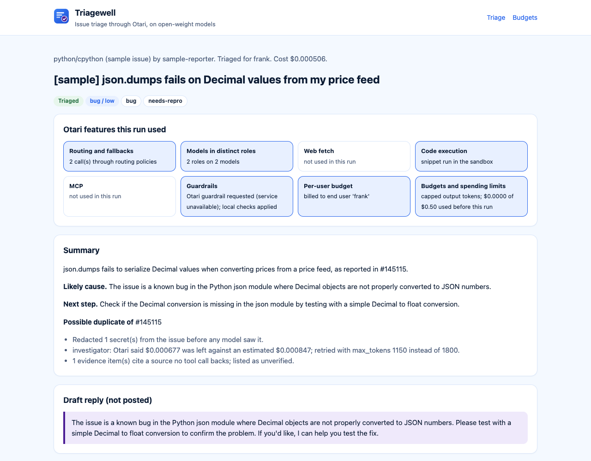

<p align="center"></p>

<h1 align="center">Triagewell</h1>

<p align="center">Issue triage for open-source maintainers, run through the <a href="https://otari.ai">Otari</a> gateway on open-weight models.</p>

A maintainer points Triagewell at a new GitHub issue. A few seconds and a fraction of a cent later they get a short report:
what kind of issue it is, whether the reporter's snippet really fails (it was run in a sandbox), similar issues that may
be duplicates, what the project's docs say about the affected part, suggested labels, one next step, and a draft reply.
Nothing is posted anywhere unless the maintainer explicitly turns posting on.

Issue trackers are public inboxes, so Triagewell treats every issue as untrusted input. Secrets pasted into an issue are
removed before any model sees them. An issue that tries to give instructions to an automated reader is quarantined:
no tools, no sandbox, no reply, just a note for a human. Every maintainer has a daily budget of their own, so a flood of
spam issues cannot burn the team's money.



Built for Mozilla's Developers Wilding hackathon. Every model call goes through Otari, and every Otari feature below is
used for a reason the feature exists, not to tick a box.

## How it uses Otari

<!-- feature-table -->
| Otari feature | How Triagewell uses it | Where |
| --- | --- | --- |
| Model routing and fallbacks | Each role calls a routing policy by name; Otari picks the provider and falls back on failure, and tiers the investigator down when a budget is 80% used. The report records `Otari-Provider`, `Otari-Model` and `Otari-Fallback` for every call. | [src/triagewell/config.py:100](src/triagewell/config.py#L100) role names are policy names<br>[src/triagewell/gateway.py:222](src/triagewell/gateway.py#L222) reads how the call was served<br>[src/triagewell/triage.py:191](src/triagewell/triage.py#L191) a missing policy falls back to the catalog model<br>[src/triagewell/triage.py:213](src/triagewell/triage.py#L213) one paced retry when every provider is busy<br>[dev/otari-local.yml:43](dev/otari-local.yml#L43) the policies, as config |
| MCP integrations | The investigator asks the repository's DeepWiki over MCP, run by Otari's managed MCP loop (inline server or a workspace-stored server id). Triagewell is also an MCP server itself, so a maintainer can triage from their editor. | [src/triagewell/triage.py:381](src/triagewell/triage.py#L381) inline MCP server on the investigator call<br>[src/triagewell/triage.py:378](src/triagewell/triage.py#L378) or the workspace's stored server<br>[src/triagewell/mcp_server.py:22](src/triagewell/mcp_server.py#L22) Triagewell's own MCP server |
| Web search or web fetch | When an issue links docs, logs or a stack trace, the investigator may read them with `otari_web_fetch`. What was really fetched comes back in `otari_tool_calls`, and evidence that cites a page nobody fetched is marked unverified. A workspace that has web access off gets the triage without the tool, not a failed call. | [src/triagewell/triage.py:372](src/triagewell/triage.py#L372) declares the fetch tool<br>[src/triagewell/triage.py:118](src/triagewell/triage.py#L118) checks claims against real tool calls<br>[src/triagewell/gateway.py:280](src/triagewell/gateway.py#L280) leaves the tool out while the workspace has it off |
| Code execution | The reporter's Python snippet runs in Otari's sandbox through `POST /code/execute` with no model in the loop, which tells the maintainer whether the bug reproduces. The investigator can also run a short check with `otari_code_execution`. | [src/triagewell/triage.py:342](src/triagewell/triage.py#L342) runs the snippet<br>[src/triagewell/gateway.py:232](src/triagewell/gateway.py#L232) the /code/execute client<br>[src/triagewell/triage.py:375](src/triagewell/triage.py#L375) model-driven checks |
| Budgets and spending limits | A key ceiling caps the team. Every call sends a realistic output cap so Otari's hold stays small. When Otari refuses because the hold does not fit, Triagewell retries once with a cap that does; when the budget is spent, the issue is deferred with Otari's `Retry-After`. A local ledger turns away new issues before they reach the gateway. | [src/triagewell/triage.py:227](src/triagewell/triage.py#L227) retry inside the remaining budget<br>[src/triagewell/triage.py:199](src/triagewell/triage.py#L199) defer on a spent budget<br>[src/triagewell/ledger.py:39](src/triagewell/ledger.py#L39) the local daily limit |
| Multiple models serving distinct roles | A small open-weight sorter classifies and extracts search terms with reasoning off, a larger open-weight investigator reasons (effort low) with tools, and Llama Guard 4 screens the drafted reply. | [src/triagewell/config.py:91](src/triagewell/config.py#L91) the three roles<br>[src/triagewell/config.py:96](src/triagewell/config.py#L96) reasoning effort per role<br>[src/triagewell/triage.py:307](src/triagewell/triage.py#L307) sorter call<br>[src/triagewell/triage.py:472](src/triagewell/triage.py#L472) reply screen |
| Guardrails | The sorter call carries Otari's `prompt-injection` guardrail and Triagewell reads its verdict from the `Otari-Guardrails` header. A flagged issue is quarantined: no tools, no sandbox, no reply. Secrets are redacted before any model sees the issue, and the reply is checked again on the way out. On otari.ai the header reads `status: unavailable` until the organization mandates a guardrail, and Triagewell's own checks still quarantine. | [src/triagewell/triage.py:304](src/triagewell/triage.py#L304) requests the guardrail<br>[src/triagewell/gateway.py:34](src/triagewell/gateway.py#L34) reads the verdict<br>[src/triagewell/guard.py:59](src/triagewell/guard.py#L59) secret redaction |
| Per-user budgets | With a service key, Triagewell names the maintainer on every request, so each maintainer is an Otari end user with a daily budget of their own; a new maintainer can start on a trial budget, and the dashboard shows Otari's own record of their spend. It checks the key first, because otari.ai refuses `user` from an ordinary key. | [src/triagewell/triage.py:177](src/triagewell/triage.py#L177) names the maintainer only with a service key<br>[src/triagewell/gateway.py:188](src/triagewell/gateway.py#L188) names the maintainer<br>[src/triagewell/gateway.py:207](src/triagewell/gateway.py#L207) picks a new maintainer's budget<br>[src/triagewell/service.py:83](src/triagewell/service.py#L83) reads Otari's end-user record |
<!-- /feature-table -->

The report page shows, for each run, which of these features that run actually used, from the gateway's own records
(response headers and `otari_tool_calls`), so a feature that was declared but never called is not counted.

## Evidence from hosted otari.ai

On 6 Nov 2026 Triagewell triaged three real, open public issues through `https://otari.ai/api/v1`, read-only with
posting off, plus the bundled prompt-injection sample. The request ids below are the `Otari-Request-ID` headers of
those calls; each one can be read back with `GET /api/v1/usage/requests/{id}` by the same key, which is how the costs
below were checked.

| Issue | Result | Cost |
| --- | --- | --- |
| [mozilla-ai/any-agent#967](https://github.com/mozilla-ai/any-agent/issues/967) LangChain agent drops `reasoning_content` | triaged, bug, high | $0.010355 (of which the sandbox run $0.01) |
| [mozilla-ai/otari#2937](https://github.com/mozilla-ai/otari/issues/2937) hosted guardrail block mode returns 502 | triaged, bug, high | $0.000194 |
| [mozilla-ai/any-llm#1545](https://github.com/mozilla-ai/any-llm/issues/1545) Bedrock async stream reads block the event loop | triaged, medium | $0.000649 |
| bundled `prompt-injection` sample | quarantined | $0.000286 |

| Otari feature | What happened on otari.ai | Request id |
| --- | --- | --- |
| Model routing and fallbacks | any-llm#1545: the investigator asked for `openai/gpt-oss-120b`; Otari's first provider did not serve it, and Otari served the call from ovhcloud (`Otari-Fallback: true`, 2 attempts; the settled record has 2 rows). The sample's investigator call fell back the same way. | `d17edb5f-c701-438b-a8bf-8e73e137a12b`<br>`bfa71b07-7882-4280-96e9-2196874636e5` |
| MCP integrations | any-llm#1545 and any-agent#967: Otari's managed MCP loop called DeepWiki's `ask_wiki_question` for the repository, listed in `otari_tool_calls` as completed. | `d17edb5f-c701-438b-a8bf-8e73e137a12b`<br>`c9ecd632-1e58-43b3-89b3-1db0cc01405e` |
| Code execution | any-agent#967: the reporter's snippet ran on `POST /code/execute`; the sandbox lacks `any_agent`, and the report says "could not run" instead of claiming a reproduction. The response carries no cost, so Triagewell read the settled $0.01 back by request id. | `402d6fa2-6606-45c2-acf2-f5846f9bb22b` |
| Multiple models serving distinct roles | Every run: Nemotron 3.5 Lightning 30B A3B (fireworks) sorts, gpt-oss-120b (deepinfra or ovhcloud) investigates, Llama Guard 4 12B (deepinfra) screens the reply. otari#2937, in order: | `45e9952b-d342-425b-ba5b-f584dec987fa`<br>`6c789dd9-eb6d-40e5-a9c5-c270009ee96f`<br>`acb6d8d9-b443-4234-9af0-3483efa81ecc` |
| Guardrails | Every sorter call asked for `prompt-injection`; otari.ai answered `status: unavailable, reason: not_configured` (no organization guardrail yet). The sample was still quarantined by Triagewell's own checks: no tools, no sandbox, no reply. | `fa919570-b553-4338-909b-9dc5f9a33872` |
| Budgets and spending limits | Every call carried an output cap (sorter 600, investigator 1800, screen 20 tokens), each report records its cost from `usage.cost_usd` and the settled sandbox charge, and the local ledger counted every run. The key ceiling and the Otari-side refusal wait on the dashboard budgets. | all of the above |
| Web fetch | Not run: the workspace has web access off. Triagewell saw `available: false` on `GET /tools` and left the tool out instead of failing. | none yet |
| Per-user budgets | Not run: the key is an ordinary key, and otari.ai refuses `user` from an ordinary key. Triagewell detected this and kept to the key budget and its local ledger. | none yet |

The hosted run also changed the code. The sorter now sends `reasoning_effort: none`, because Nemotron spent its whole
output cap reasoning and returned no answer. Sandbox runs are billed ($0.01 each) but answer without a cost, so the
report reads the settled amount back. The investigator retries once without tools when the CDN in front of
otari.ai times out a long tool loop (504 after about a minute), and once after a pause when every provider is busy (429).
[SETUP-OTARI.md](SETUP-OTARI.md) lists the dashboard steps that turn on the two features not yet run.

## Models

All three roles use open-weight models from Otari's catalog. Each role is a routing policy, so the provider and the
fallbacks live in Otari, not in this code.

| Role | Policy | Model (first choice) | Fallbacks | Why this size |
| --- | --- | --- | --- | --- |
| Sorter | `triagewell-sorter` | NVIDIA Nemotron 3.5 Lightning 30B A3B | same model on a second provider, then gpt-oss-20b | Classifying and extracting search terms is easy; it runs on every issue, so it should be cheap and fast. |
| Investigator | `triagewell-investigator` | OpenAI gpt-oss-120b | same model on a second provider, then DeepSeek V4.1 Flash; gpt-oss-20b once a budget is 80% used | Tool use and reasoning over code and docs need a stronger model. |
| Reply screen | none (single model) | Meta Llama Guard 4 12B | none: if it is unavailable the screen is skipped and recorded | A safety classifier reads the drafted reply before a human sees it. |

## Safe by default

* Read-only on GitHub. Triagewell only sends GET requests to the GitHub API.
* Draft replies go to a local outbox (`.triagewell/outbox/`). Posting a comment needs all of: `TRIAGEWELL_ALLOW_POST=1`,
  the repository listed in `TRIAGEWELL_POST_REPOS`, a `GITHUB_TOKEN`, the `--post` flag, a report that was not
  quarantined, and a reply that passed the secret scan and the safety screen.
* Secrets (GitHub, AWS, OpenAI-style, Otari, Slack, Google, Hugging Face keys, private keys, JWTs, `*_TOKEN=` style
  assignments) are redacted before the issue reaches the gateway, and the reply is scanned again on the way out.
* Issue text is fenced as untrusted data in every prompt. A quarantined issue never chooses its own next step.
* Evidence the model cites from a page or the wiki that no tool call fetched is shown separately as unverified.
* Labels are limited to a fixed list, and a suggested duplicate must be one the GitHub search actually found.

## Quick start

You need [uv](https://docs.astral.sh/uv/) and Python 3.12 or newer.

```bash
git clone <this repository> triagewell
cd triagewell
uv sync
cp .env.example .env
```

Then follow [SETUP-OTARI.md](SETUP-OTARI.md) to create the otari.ai key, budgets, routing policies and tool settings
(about fifteen minutes, no card), and put the key in `.env` as `OTARI_API_KEY`. Check the setup:

```bash
uv run triagewell doctor
```

Triage a bundled sample issue (a Decimal bug with a pasted fake token), then the prompt-injection sample:

```bash
uv run triagewell triage --sample pasted-token --as alice
uv run triagewell triage --sample prompt-injection --as alice
```

Triage a real public issue, read-only:

```bash
uv run triagewell triage mozilla-ai/any-llm#1577 --as alice
uv run triagewell scan mozilla-ai/any-llm --since-hours 72 --limit 2 --as alice
```

With the service key and budgets from SETUP-OTARI.md, start a new maintainer on the small trial budget and watch Otari
stop them:

```bash
uv run triagewell triage --sample pasted-token --as carol --budget maintainer-trial
uv run triagewell triage --sample pasted-token --as carol --budget maintainer-trial
uv run triagewell budget --as carol
```

The dashboard, at http://127.0.0.1:8765:

```bash
uv run triagewell serve
```

## From your editor (MCP)

`triagewell mcp` is a stdio MCP server with read-only tools: `triage_issue`, `triage_sample`, `list_samples`,
`recent_reports`, `get_report` and `maintainer_budget`. Add it to any MCP client, for example:

```json
{
  "mcpServers": {
    "triagewell": {
      "command": "uv",
      "args": ["run", "--directory", "/absolute/path/to/triagewell", "triagewell", "mcp"]
    }
  }
}
```

## Without an otari.ai account

Otari is open source, so the whole pipeline also runs against a local gateway with small open-weight models on
[Ollama](https://ollama.com). [dev/otari-local.yml](dev/otari-local.yml) declares the same routing policies, budgets
and service key that SETUP-OTARI.md creates in the dashboard.

```bash
ollama pull qwen3:0.6b && ollama pull qwen3:1.7b && ollama pull gemma3:4b
dev/run-local-gateway.sh
```

The script clones Otari into `.otari-src/`, writes two fresh secrets to `dev/.env.local-gateway`, and serves the gateway
on port 8000. In another terminal, point `.env` at it (`OTARI_BASE_URL=http://127.0.0.1:8000/api/v1`, and
`OTARI_API_KEY` set to the `TRIAGEWELL_SERVICE_KEY` value from that file) and run the commands above. For code
execution, also run Otari's sandbox container as the script's header describes.

## Tests

```bash
uv run pytest
```

The suite runs offline: the Otari gateway and the GitHub API are replaced by fakes on `httpx.MockTransport` that answer
the way the real ones do (headers, `otari_tool_calls`, budget and guardrail refusals). It also checks that no secret
from an issue ever reaches the gateway, that GitHub is only read, and that the table above matches the code.

## Layout

| Path | What it holds |
| --- | --- |
| `src/triagewell/triage.py` | The pipeline: sort, search duplicates, run the snippet, investigate, screen |
| `src/triagewell/gateway.py` | The Otari client: chat, code execution, end users, tools, guardrail profiles |
| `src/triagewell/guard.py` | Secret redaction, injection signals, untrusted-text fencing |
| `src/triagewell/ledger.py` | Local per-maintainer spending ledger |
| `src/triagewell/github.py` | Read-only GitHub client |
| `src/triagewell/outbox.py` | Local outbox and the gated GitHub poster |
| `src/triagewell/web.py`, `mcp_server.py`, `cli.py` | The three ways in |
| `fixtures/issues/` | Sample issues (marked as samples, with fake secrets) |
| `dev/` | Local gateway config and the README table generator |

## License

Apache 2.0.
